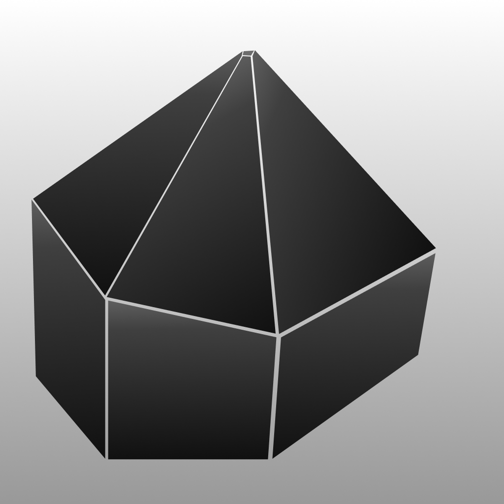

<p align="center">
  
</p>

<h1 align="center">Canopy</h1>

<p align="center">
  <b>One canvas for your terminals and coding agents.</b><br>
  <a href="#install">Install</a> · <a href="https://github.com/Krishnapthm/canopy/wiki/Quick-Start">Quick start</a> ·
  <a href="https://github.com/Krishnapthm/canopy/wiki">Docs</a> · <a href="#build-from-source">Build from source</a> ·
  <a href="CONTRIBUTING.md">Contributing</a>
</p>

Put terminals and agents on one canvas, connect them with wires, and see which agent needs you.
Terminals keep running when you close the window. Canopy runs them on
[herdr-core](https://github.com/herdrdev/herdr-core).

## Install

macOS (Apple Silicon) and Linux:

```sh
curl -fsSL https://github.com/Krishnapthm/canopy/releases/latest/download/install.sh | sh
```

The installer adds Canopy and, if it is missing, herdr-core.
Open Canopy from your apps or run `canopy`.
Then follow the [Quick start](https://github.com/Krishnapthm/canopy/wiki/Quick-Start).

To update, run the installer again. The app never updates itself.

To uninstall, delete the app and its config in `~/.config/canopy`:

- macOS: `~/Applications/Canopy.app` and the `~/.local/bin/canopy` link.
- Linux: `~/.local/share/canopy`, `~/.local/bin/canopy`,
  `~/.local/share/applications/canopy.desktop` and
  `~/.local/share/icons/hicolor/scalable/apps/canopy.svg`.

herdr-core stays, because other apps can use it.

## Docs

The [wiki](https://github.com/Krishnapthm/canopy/wiki) has every feature, how to use it and how to fix problems.

## Build from source

### 1. Install the tools

- [Rust](https://rustup.rs) 1.95 or newer
- [Zig](https://ziglang.org/download/) 0.16, which builds the terminal engine
- [herdr-core](https://github.com/herdrdev/herdr-core), which runs your terminals
- Optional: [just](https://github.com/casey/just) and [Bun](https://bun.sh) for the full test suite

**macOS**, with the Xcode Command Line Tools and [Homebrew](https://brew.sh):

```sh
xcode-select --install
curl --proto '=https' --tlsv1.2 -sSf https://sh.rustup.rs | sh
brew install zig@0.16 just oven-sh/bun/bun
export PATH="$(brew --prefix zig@0.16)/bin:$PATH"
```

Homebrew's `zig@0.16` is keg-only, so add that `export` line to your shell profile.

**Linux** (Debian or Ubuntu), with Zig 0.16 from [ziglang.org](https://ziglang.org/download/) on your `PATH`:

```sh
sudo apt-get install build-essential pkg-config clang libclang-dev \
  libxcb1-dev libxkbcommon-dev libxkbcommon-x11-dev libwayland-dev \
  libvulkan-dev mesa-vulkan-drivers libfontconfig-dev libfreetype-dev
curl --proto '=https' --tlsv1.2 -sSf https://sh.rustup.rs | sh
```

**herdr-core**, on both:

```sh
curl -fsSL https://releases.herdr.dev/core/install.sh | sh
```

### 2. Clone and build

```sh
git clone https://github.com/Krishnapthm/canopy.git
cd canopy
cargo build --locked
```

### 3. Test

```sh
cargo test --locked
just test    # also runs the Bun mod and script tests
```

### 4. Run it

Open a development window with its own scratch home and core, so it never touches your installed Canopy:

```sh
scripts/dev
```

Close that window, then stop its core:

```sh
scripts/dev-stop
```

Don't run the debug binary directly: it would use your real app home and core.
[Build from source](https://github.com/Krishnapthm/canopy/wiki/Build-from-Source) in the wiki covers the checks before a pull request, the Linux sandbox and Windows checkouts.

## Thanks to herdr

Canopy stands on [herdr](https://github.com/herdrdev). It began as a fork of
[herdr-app](https://github.com/herdrdev/herdr-app), and every terminal you open in Canopy runs on
[herdr-core](https://github.com/herdrdev/herdr-core). Thank you to the herdr authors for the
foundation and for releasing it under Apache-2.0.

## License

Apache-2.0, like herdr-app. See LICENSE, NOTICE and THIRD-PARTY-NOTICES.
