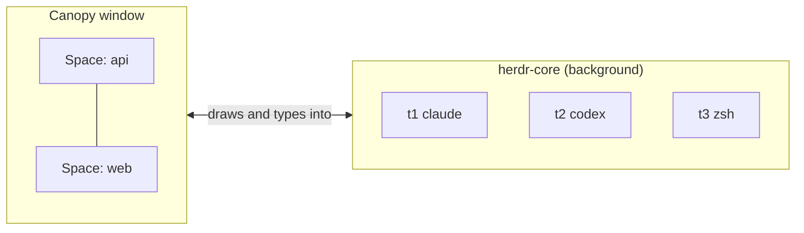

# Concepts

This page explains the handful of ideas Canopy is built from and how they fit together. Read it after the [Quick Start](Quick-Start), or before it if you like to know the shape of a tool before you touch it. Each section links to the page with the details.

## The big picture

Canopy is two programs. The **window** is what you see and click. **herdr-core** (its command is `hc`) runs in the background and owns every terminal and agent. The window connects to the core, draws your terminals, and sends your keystrokes to them.



Inside the window, your work is organized into spaces. Each space has a canvas, and everything on a canvas is a pane.

## Spaces and Home

A **space** is a room for one project. It has a folder, a name, a color and its own canvas. New terminals and agents in a space start in its folder. You might have one space for your API, one for the web app, and one for a branch you are experimenting on.

**Home** is the zoomed-out view of all your spaces, shown as cards. Each card tells you how many terminals are running and how many agents are working, and shows a bell when an agent in it needs you. Use Home to see your whole day at a glance and to jump between projects.

Details: [Spaces](Spaces).

## The canvas and panes

The **canvas** is an open, zoomable surface, closer to a design tool than a terminal emulator. You place panes anywhere, drag them around, zoom out to see everything or tile them into a grid when you want to focus.

A **pane** is anything on the canvas:

| Pane | What it is for |
|---|---|
| [Terminal](Terminals) | A shell or any program. |
| [Agent](Agents) | A terminal running a coding agent CLI, such as Claude Code or Codex. |
| [Sub-agent](Sub-Agents) | A helper an agent started, shown next to it. |
| [File](File-and-Note-Panes) | A text file you want in view, or want an agent to see. |
| [Note](File-and-Note-Panes) | Text you type for yourself or your agents: a plan, a checklist. |
| [Image, PDF](Images-and-PDFs) | A screenshot, a design, a spec. |
| [Browser](Browser-Pane) | A web page, usually your own dev server (macOS). |
| [Simulator](Simulator-Devices) | A live iOS Simulator (macOS with Xcode). |

Mods can add their own pane kinds. Every pane gets the same small **helper bar** of buttons when you hover or select it, so the common actions for each kind are always one click away.

Details: [Canvas](Canvas), [Panes](Panes).

## Typing into a pane and canvas mode

Because the canvas is full of terminals, Canopy has to know whether a keypress is meant for a terminal or for the canvas itself.

- When you **enter** a pane, by double-clicking it or selecting it and pressing `Enter`, the pane has the keyboard. Everything you type, including `Esc`, goes to the program inside.
- In **canvas mode**, the canvas has the keyboard. Single keys act on panes: `n` opens a terminal, `f` fits the selection to the screen, `c` starts a wire, arrow keys move the selected pane, and so on.

Click empty canvas, or press `Cmd+Esc` (`Ctrl+Esc` on Linux and Windows), to leave a pane and return to canvas mode. A single click on a pane selects it without entering it, which is what lets you drag terminals around without typing into them.

Details: [Terminals](Terminals#enter-a-terminal), [Keys and Mouse](Keys-and-Mouse).

## Agents and their states

An **agent** is a coding agent CLI running in a terminal pane. Canopy does not wrap or replace it: it is the same `claude` or `codex` you run anywhere else, started in your space's folder. herdr-core watches each agent and reports one of four states:

| State | Meaning | What you see |
|---|---|---|
| Working | The agent is busy. | A spinner next to its name. |
| Blocked | The agent is waiting for you: a question, a permission prompt. | A bell next to its name and on its space's card. |
| Done | It finished a turn you have not looked at yet. | **Done** in the agents list. |
| Idle | Nothing new. | No marker. |

When an agent becomes blocked, or finishes while you are not looking at it, Canopy also shows a toast you can click to jump to it, and plays a sound if sounds are on.

The point of these states is that you can stop watching agents. Start a few, go do something else, and let Canopy call you back when one needs a decision or has something to show.

Details: [Agents](Agents).

## Wires: introductions between panes

A **wire** is a line you draw between two panes in the same space. It tells the agents on each end that the other exists and how to reach it.

Wires do not carry text on their own, and they do not restrict anything. When an agent wants to talk to a peer, it runs `canopy wire` to see who it is wired to, then sends a message with herdr-core:

```sh
canopy wire                      # who am I, and who am I wired to?
hc send t2 "Your tests fail on main, see @src/api.rs:40-52"
```

The message arrives in the other agent's prompt wrapped as `<hc from="t1 claude">...</hc>`, so it always knows the message came from a peer, not from you. Canopy's instructions tell agents that a peer's message is never your approval, so an agent should still ask you before anything risky, whoever suggested it.

You can also wire a file, note, browser or simulator pane to an agent. The agent then sees that pane in `canopy wire` and can read it.

Details: [Wiring](Wiring), and the [Pair Agents](Pair-Agents) guide.

## Quotes: pointing at things

A **quote** sends a selection from a pane into an agent's prompt: lines from a file, a region of an image, a passage from a PDF, an element on a web page, or a marked-up simulator screenshot. You pick the agent from a menu (wired agents first) and can add a message.

Canopy pastes the quote but never presses `Enter`. You always see what will be sent and decide when to send it.

Details: [Quotes](Quotes), and the [Point Agents at Things](Point-Agents-at-Things) guide.

## Helpers and sub-agents

Agents can start other agents, and Canopy keeps them visible.

- A **helper** is a full agent another agent starts with `canopy spawn`. It runs in its own terminal next to its parent, already wired to it, and reports back with `hc send` when it is done or stuck. You can enter it and talk to it like any agent.
- An **in-process sub-agent** is one an agent runs inside itself, such as Claude Code's built-in sub-agents. Canopy shows each as a small pane next to the parent, marked working then done, with a read-only transcript you can follow.

Details: [Sub-Agents](Sub-Agents), and the [Delegate to Helpers](Delegate-to-Helpers) guide.

## herdr-core: why nothing dies with the window

Every terminal you open in Canopy is really a terminal in herdr-core. The window is a view onto them. This has some useful consequences:

- Close Canopy, update it, or have it crash, and your agents keep running. Reopen it and everything is where you left it.
- A server or a second Mac can run its own herdr-core, and Canopy can show its spaces next to your local ones. Those agents keep working while your laptop sleeps. See [Machines](Machines).
- Any terminal can drive another with `hc`: read its screen, send it a line, wait for it to finish. Agents use exactly this to talk to each other.

Terminals stop when you close them, when the program in them exits, or when the computer shuts down.

Details: [herdr-core](herdr-core).

## How agents learn Canopy

An agent only uses wires, panes and helpers if it knows they exist. Canopy teaches agents in three layers:

1. **The `canopy` skill.** Canopy installs a skill into the global skills folder of supported agents (Claude Code and Codex). Agents load it when a task involves panes, wiring, quotes or helpers.
2. **A launch note.** When Canopy starts Claude Code or Codex, it passes a short note saying the agent runs inside Canopy, how to reach peers, and that peer messages are not approval.
3. **A project block.** With your permission, Canopy adds a short marked block to your project's `AGENTS.md` or `CLAUDE.md`, so any agent working in that project knows to use the skill.

Other agent CLIs run fine in Canopy, but know about it only through the project block or what you tell them.

Details: [Agent Setup](Agent-Setup).

## Layouts and mods: the window is files

The whole window, from the toolbar to the space tabs, is built from **layouts** (JSON files that arrange the window) and **mods** (small JavaScript programs that draw parts of it or add pane kinds). They live in your app home, `~/.config/canopy`, as plain files.

That means you can change almost anything, and so can your agents. Ask one to "move the toolbar to the top" or "add a panel listing my open pull requests", and it can edit the files while Canopy reloads them live. Canopy also ships other layouts, including a classic editor-style window with a sidebar of agents.

Details: [Layouts and Mods](Layouts-and-Mods), [Classic Layout](Classic-Layout).

## Next

- Pick a guide from the [Home](Home#where-to-start) page.
- Look up any word in the [Glossary](Glossary).
