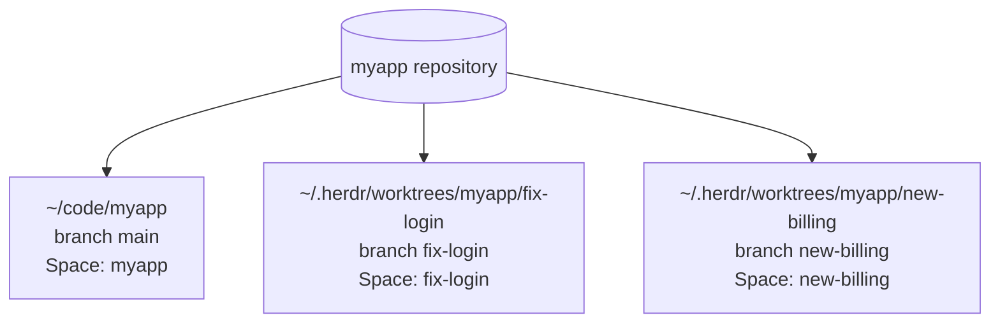

# Parallel Branches

Two agents editing the same checkout will trip over each other: one runs the tests while the other is halfway through a refactor, or both edit the same file. The clean fix is to give each line of work its own Git worktree, a second checkout of the same repository on its own branch, and its own space in Canopy. This guide shows how.

## The idea

A Git worktree is an extra working folder linked to your repository. Each worktree has its own branch and its own files, but they share history, so commits in one are visible from the others without pushing.

In Canopy, a space points at one folder. Point a space at each worktree and you get one canvas per branch: its own agents, terminals and dev server, all running at the same time, all visible from Home.



## Create worktree spaces in the Classic layout

Canopy's worktree dialogs live in the sidebar of the Classic layout, which lists your spaces and groups each worktree under its main checkout.

1. Open the command palette with `Cmd+Shift+P` (`Ctrl+Shift+P` on Linux and Windows) and select **Layout: Classic**.
2. In the sidebar's **Spaces** list, right-click the space for your repository.
3. Select **New worktree**, type a branch name such as `fix-login`, and press `Enter`.

Canopy creates the checkout under `~/.herdr/worktrees/<repo>/`, using the branch if it exists or creating it from the current checkout, and opens a new space for it. Start an agent there and it works on that branch only.

To get back to a worktree you made earlier, select **Open worktree** from the same menu, type to filter, and press `Enter`.

You can switch back to the canvas with **Layout: Canopy** at any time. The worktree spaces stay, and they show up on Home like any other space.

## Create worktree spaces from the canvas

On the canvas layout there is no worktree menu, but you do not need one. Any folder can be a space:

1. Create the worktree with Git, or ask an agent to:

   ```sh
   git worktree add ../myapp-fix-login -b fix-login
   ```

2. Click **+** in the top strip to open **New space**, choose the new folder, and click **Open space**.

The result is the same: a space whose agents and terminals run in that checkout.

## Work across branches

With a space per branch, a typical session looks like this:

- **Home shows everything.** Each space card shows how many agents are working, and a bell when one needs you. You can leave three branches running and check in where needed.
- **Switch with the keyboard.** `Cmd+1` through `Cmd+9` (`Ctrl+1` through `Ctrl+9` on Linux and Windows) jump to spaces in tab order, and `Ctrl+Tab` flips back to the last one.
- **Helpers per branch.** Ask the agent in each space to start its own helpers. They start in that space's folder, so they stay on its branch. See [Delegate to Helpers](Delegate-to-Helpers).
- **Review across branches.** Wires connect panes in the same space only. To have an agent review another branch's work, ask it to read that branch's diff with Git (`git diff main...fix-login`), which works from any worktree.

## Clean up

When a branch is merged, remove its worktree.

> **Warning:** Removing a worktree deletes the checkout folder and ends the space's terminals. Uncommitted changes and unpushed submodule commits in it are lost. The branch itself stays.

In the Classic layout, right-click the worktree's space and select **Remove worktree**, then press `Enter` to confirm. The main checkout cannot be removed this way. From a terminal, `git worktree remove <path>` does the same, after which you delete the space from Home (right-click its card, **Delete space**).

## See also

- [Spaces](Spaces): everything about creating, switching and deleting spaces.
- [Classic Layout](Classic-Layout): the sidebar where worktree spaces are grouped.
- [Machines](Machines): spaces on another computer, for branches that need a bigger machine.
